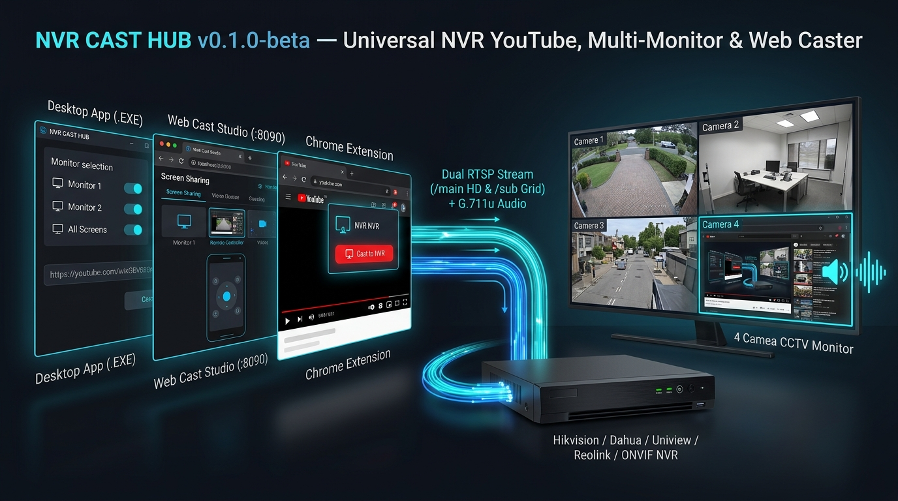
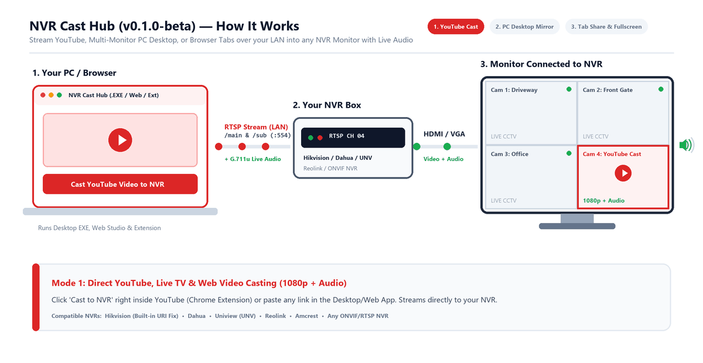
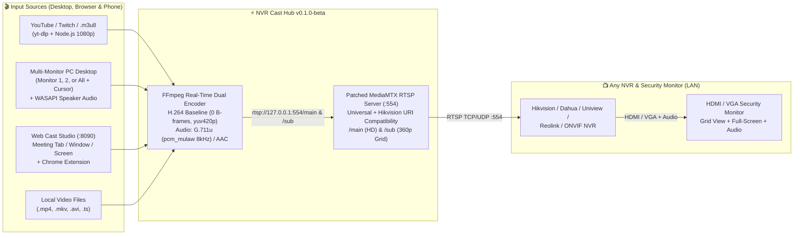

# 📺 NVR Cast Hub (`v0.1.0-beta`)

### **Turn Any NVR or CCTV Security Monitor into a Live YouTube Player, Multi-Monitor PC Desktop Mirror & Meeting Screen Caster — Over Your Existing Network (`RTSP`) with Audio**

[](https://github.com/iamahsanmehmood/nvr-cast-hub/releases/tag/v0.1.0-beta)
[](https://github.com/iamahsanmehmood/nvr-cast-hub/releases)
[](#%EF%B8%8F-supported-nvr--cctv-brands)
[](LICENSE)

<p align="center">
  
</p>

<p align="center">
  
</p>

---

## 🧩 A Complete 3-in-1 Casting Ecosystem (Not Just a Script or Extension)

**NVR Cast Hub (`v0.1.0-beta`)** is a complete, self-contained software suite that lets you cast entertainment, live streams, presentations, or your computer monitors directly onto the HDMI/VGA screen connected to your **Network Video Recorder (NVR)**—Right alongside your live security cameras:

| Component | Folder / Executable | What It Does |
| :--- | :--- | :--- |
| 🖥️ **1. Native Desktop App & RTSP Server** | **`NVR_Cast_Hub.exe`** / [`desktop_app/`](desktop_app/) | Standalone Windows GUI + embedded RTSP server (`:554`) that broadcasts dual HD (`/main`) & SD Grid (`/sub`) streams, captures single or multiple PC monitors with system audio, and streams YouTube/Web videos directly. |
| 🌐 **2. Browser Web Cast Studio & Phone Remote** | `http://localhost:8090` / [`web_studio/`](web_studio/) | Built-in web application accessible from any browser on your PC or **mobile phone on Wi-Fi (`http://<PC-IP>:8090`)**. Share any Browser Tab, Application Window, or Screen (just like Google Meet / Zoom) with live audio, paste video links, or tune stream quality on the fly. |
| 🧩 **3. Chrome / Edge Browser Extension** | [`chrome_extension/`](chrome_extension/) | Manifest v3 browser extension that injects a native **`📺 Cast to NVR`** button directly inside the **YouTube video player bar** (syncing your exact playback timestamp) plus a 1-click toolbar remote. |

---

## 💡 The Problem We Solved (And Why Everyone Said It Was Impossible)

Millions of homes, offices, shops, and control rooms have a dedicated HDMI/VGA monitor plugged directly into an **NVR (Hikvision, Dahua, Uniview, Reolink, Amcrest, etc.)** displaying security cameras 24/7.

When you want to use that same monitor to **watch a YouTube video, follow a live news/sports stream, mirror your PC desktop, or share a presentation**, you hit a wall:

1. **NVRs Are Closed, One-Way Appliances:** An NVR has no HDMI input port, no web browser, and no Chromecast, AirPlay, or Miracast receiver. Its hardware is engineered strictly to **pull** incoming video streams from IP cameras over the local network (`RTSP`) and render them onto a camera grid.
2. **Why Standard Advice Tells You to Buy Extra Hardware:** Because NVRs cannot accept standard cast protocols, conventional advice tells you to buy a physical HDMI switch + external streaming stick (losing visibility of your security cameras whenever you switch HDMI inputs) or try basic phone RTSP camera apps that suffer from **severe lag, zero audio, and black screens on YouTube**.

### 🚀 Our Solution: Turn Your PC & Browser Into a "Virtual Smart IP Camera"

Instead of modifying the NVR or unplugging HDMI cables, **NVR Cast Hub** runs on any computer on your LAN and emulates a **hardware-compliant Dual-Stream RTSP IP Camera** (`rtsp://<YOUR_PC_IP>:554/main` and `/sub`).

Your NVR treats your Cast Hub just like another security camera channel:
- Watch **YouTube, Live TV, or your PC Desktop** inside one tile of your 4-camera / 8-camera grid while keeping all your real security cameras visible, **or**
- Double-click the Cast channel on your NVR mouse/monitor to expand it into **1080p / 720p Full-Screen with live audio** through your monitor speakers!

| Conventional Myth / Limitation | How **NVR Cast Hub (`v0.1.0-beta`)** Solves It |
| :--- | :--- |
| *"Fake RTSP streams fail with `No Network Video` or `Offline` on NVRs."* | Simultaneously encodes **Main Stream (`/main`)** and **Sub Stream (`/sub`)** using strict **H.264 Baseline Profile (`yuv420p`, `0 B-frames`, 2-second GOP)** required by NVR hardware ASIC decoders, plus an **Always-On Standby Screen** so the channel never drops offline. |
| *"Hikvision NVRs reject custom RTSP servers with `400 Bad Request`."* | **Built-in Hikvision Firmware Fix:** Automatically patches `mediamtx.exe` to accept Hikvision's non-standard `rtsp:<ip>/main` URI handshake (missing `//`) and routes both `/main` and `/sub` seamlessly. |
| *"RTSP camera streams on NVRs have no audio."* | Transcodes YouTube, browser tab, and PC speaker audio in real time into **ITU-T G.711u (`pcm_mulaw` @ 8kHz mono)**, **G.711a**, or **AAC** so sound plays directly out of your NVR's HDMI/VGA monitor speakers. |
| *"You can't cast YouTube without screen-recording DRM black screens."* | Uses **`yt-dlp` + Node.js runtime** to extract raw 1080p adaptive video + audio streams directly from YouTube, Twitch, Facebook, or `.m3u8` URLs and pipes them straight into the RTSP server. |
| *"Multi-monitor PC desktop mirroring fails or has no system sound."* | Captures directly from Windows **`WinSta0\Default`** (`mss`) across **Monitor 1, Monitor 2 (including vertical/portrait monitors), or All Monitors Combined**, with live mouse pointer rendering and **WASAPI PC Speaker Audio Loopback** (`pyaudiowpatch`). |

---

## 🛡️ Supported NVR & CCTV Brands

Because **NVR Cast Hub** outputs standard **RTSP over TCP/UDP** on port `554` with selectable CCTV audio codecs (`G.711u`, `G.711a`, `AAC`), it works across all major NVR brands:

- ✅ **Hikvision NVRs** *(Special built-in compatibility patch for Hikvision's `rtsp:<ip>/main` Custom Protocol URI quirk — tested and verified live!)*
- ✅ **Dahua NVRs** *(WizSense, Pro & Lite Series via `Customized` RTSP protocol)*
- ✅ **Uniview (UNV) NVRs** *(via `Custom` RTSP protocol)*
- ✅ **Reolink, Amcrest, Lorex, Swann, Annke & Night Owl NVRs** *(any model supporting Custom RTSP / ONVIF IP channels)*
- ✅ **VMS & NAS Platforms:** Synology Surveillance Station, Blue Iris, Frigate, ZoneMinder, Milestone XProtect, and VLC / Smart TVs.

👉 **[Read the Step-by-Step Brand Setup Guide (`docs/NVR_BRAND_SETUP_GUIDE.md`)](docs/NVR_BRAND_SETUP_GUIDE.md)**

---

## 🏗️ System Architecture



---

## ✨ Key Features in `v0.1.0-beta`

### 1. 🖥️ Native Windows Desktop Application (`NVR_Cast_Hub.exe` & `desktop_app/`)
- **1-Click RTSP URLs:** Automatically detects your PC's LAN IP and displays copy-ready **Main Stream (`/main`)**, **Sub Stream (`/sub`)**, and **Web Cast Studio (`http://localhost:8090`)** addresses.
- **Multi-Monitor Selection:** Dynamically detects all displays (e.g. `Monitor 1: 1920x1080 Landscape` + `Monitor 2: 1080x1920 Vertical/Portrait`). Choose **Monitor 1 Only**, **Monitor 2 Only**, **All Monitors Combined**, or any custom subset.
- **WASAPI PC Speaker Audio Loopback:** Streams whatever audio is playing on your PC speakers directly to your NVR monitor without needing a microphone or virtual audio cable.
- **Live Flexibility & Encoding Controls:** Adjust Resolution (`1280x720`, `1920x1080`, `854x480`), Aspect Fit (`Fit/Letterbox`, `Stretch`, `Center Crop`), Frame Rate (`15`, `25`, `30` FPS), Bitrate (`1000k`–`4000k`), and Audio Codec (`G.711u`, `G.711a`, `AAC`, `Mute`).

### 2. 🌐 Browser Web Cast Studio & Mobile Remote (`http://localhost:8090` & `web_studio/`)
- **Google-Meet-Style Screen / Window / Tab Sharing:** Click **`📹 Share Browser Tab / Window / Screen`** in your browser to share a single Chrome tab (with tab audio), a specific app window, or a monitor.
- **Phone / Tablet Wi-Fi Remote:** Open `http://<YOUR_PC_IP>:8090` on your phone to paste YouTube links, switch monitors, or stop casting from across the room.

### 3. 🧩 Chrome / Edge Browser Extension (`chrome_extension/`)
- **In-Player YouTube Cast Button:** Adds a native **`📺 Cast to NVR`** button right inside the YouTube video player bar next to Fullscreen—automatically transferring the video and your current playback timestamp to the NVR!
- **Toolbar Quick-Cast Popup:** Cast any tab's video URL, start Meeting Share, or toggle Monitor 1 / Monitor 2 / All Screens with one click.

---

## 📂 Project Structure

```text
nvr-cast-hub/
├── desktop_app/                 # 1. Native Windows Desktop GUI & Universal RTSP Engine
│   ├── __init__.py
│   ├── engine.py                # MediaMTX manager, FFmpeg dual encoder, Multi-Monitor & WASAPI audio
│   └── gui.py                   # Tkinter Desktop Control Center UI
├── web_studio/                  # 2. Browser Web Cast Studio & Mobile Remote (:8090)
│   ├── __init__.py
│   └── server.py                # HTTP dashboard, REST API & WebM live chunk receiver
├── chrome_extension/            # 3. Chrome / Edge / Brave Extension (Manifest v3)
│   ├── manifest.json            # Extension manifest (v0.1.0)
│   ├── popup.html               # Toolbar remote UI
│   ├── popup.js                 # Toolbar remote logic
│   └── content_youtube.js       # Injects "📺 Cast to NVR" button into YouTube player
├── docs/                        # 4. Multi-Brand Setup & Technical Architecture Docs
│   ├── NVR_BRAND_SETUP_GUIDE.md # Setup for Hikvision, Dahua, Uniview, Reolink, Amcrest, ONVIF
│   └── ARCHITECTURE.md          # Engineering deep-dive (Hikvision URI patch, G.711u, WinSta0)
├── scripts/                     # 5. One-Click Setup, Run & Single-EXE Build Scripts
│   ├── Setup_Dependencies.bat   # Installs Python deps, FFmpeg & Node.js
│   ├── Run_Desktop_App.bat      # Launches Desktop GUI + Web Cast Studio
│   └── Build_Single_EXE.bat     # Compiles standalone NVR_Cast_Hub.exe via PyInstaller
├── nvr_cast_app.py              # Unified application entry point
├── requirements.txt             # Python dependencies (yt-dlp, mss, pyaudiowpatch, pyinstaller)
├── LICENSE                      # MIT License
└── README.md                    # Project documentation
```

---

## 🚀 Quick Start Guide

### Option A: Run the Standalone Portable Executable (`NVR_Cast_Hub.exe`)
1. Download **`NVR_Cast_Hub_v0.1.0-beta_Complete_Suite.zip`** or **`NVR_Cast_Hub.exe`** from the [**Releases Page**](https://github.com/iamahsanmehmood/nvr-cast-hub/releases/tag/v0.1.0-beta).
2. Make sure **FFmpeg** is installed on your Windows PC (if not, run `winget install Gyan.FFmpeg` in PowerShell or run `scripts\Setup_Dependencies.bat`).
3. Double-click **`NVR_Cast_Hub.exe`**.
   - On first run, it automatically extracts `bin/mediamtx.exe` (with the Hikvision RTSP patch applied) and `chrome_extension/` beside the executable.
   - Both the **Desktop Control Center GUI** and the **Browser Web Cast Studio (`http://localhost:8090`)** start immediately!

### Option B: Run from Python Source
```bash
git clone https://github.com/iamahsanmehmood/nvr-cast-hub.git
cd nvr-cast-hub
pip install -r requirements.txt
python nvr_cast_app.py
```

### Option C: Install the Chrome / Edge Extension (Optional)
1. Open Chrome or Edge and go to `chrome://extensions/`.
2. Enable **Developer mode** (top-right toggle).
3. Click **Load unpacked** and select the `chrome_extension` folder.

---

## 📹 Connecting Your NVR (Hikvision, Dahua, Uniview, Reolink, ONVIF)

1. Look at **Section 1** of the **NVR Cast Hub** window to see your PC's RTSP URLs:
   - **Main Stream (HD):** `rtsp://<YOUR_PC_IP>:554/main`
   - **Sub Stream (Grid):** `rtsp://<YOUR_PC_IP>:554/sub`
2. Add a **Custom RTSP Camera** on your NVR pointing to `<YOUR_PC_IP>`, Port `554`, Main Path `/main`, Sub Path `/sub` (Username: `admin`, Password: `12345`).
3. Enable the **Speaker / Audio icon** on that camera channel on your NVR monitor.
4. For step-by-step instructions for **Hikvision, Dahua, Uniview, Reolink, Amcrest, and Synology**, see **[`docs/NVR_BRAND_SETUP_GUIDE.md`](docs/NVR_BRAND_SETUP_GUIDE.md)**.

---

## 👤 Author & License

Developed by **Ahsan Mehmood** ([@iamahsanmehmood](https://github.com/iamahsanmehmood)).  
Released under the [MIT License](LICENSE).
