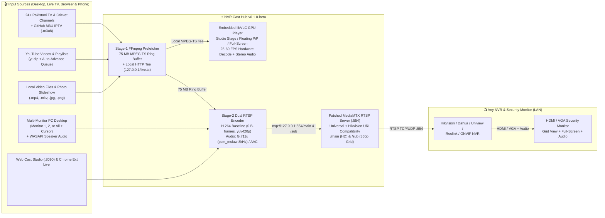

# 📺 NVR Cast Hub (`v0.1.0-beta`)

### **Turn Any NVR / CCTV Security Monitor — or Your PC Desktop — into a Hardware-Accelerated Live TV & Cricket Studio, YouTube Playlist Player, Multi-Monitor Desktop Mirror & Meeting Screen Caster (`RTSP` + Embedded `libVLC` Player)**

[](https://github.com/iamahsanmehmood/nvr-cast-hub/releases/tag/v0.1.0-beta)
[](https://github.com/iamahsanmehmood/nvr-cast-hub/releases)
[](#%EF%B8%8F-supported-nvr--cctv-brands)
[](LICENSE)

<p align="center">
  
</p>

---

## 🧩 A Complete 3-in-1 Casting & Live TV Ecosystem

**NVR Cast Hub (`v0.1.0-beta`)** is a complete, self-contained software suite that lets you watch and cast **Pakistani Live TV & Cricket channels, YouTube videos & playlists, GitHub M3U IPTV streams, presentations, or your computer monitors** either **directly inside the Desktop Studio App (with Floating PiP & Full-Screen TV modes)**, **onto your NVR's HDMI/VGA security monitor**, or **both simultaneously**:

| Component | Folder / Executable | What It Does |
| :--- | :--- | :--- |
| 🖥️ **1. Native Broadcast Studio App, Embedded `libVLC` Player & RTSP Server** | **`NVR_Cast_Hub.exe`** / [`desktop_app/`](desktop_app/) | Modern Dark Broadcast Studio GUI with an **embedded GPU hardware-accelerated `libVLC` player** (`25–60 fps`), **Floating Always-On-Top Picture-in-Picture (PiP) Mini-Player**, **100% Full-Screen TV Mode (`F11`)**, **3-Way Output Routing (`Preview Only`, `Both`, `NVR Only`)**, **24+ built-in Pakistani Live TV & Cricket channels**, YouTube playlist auto-play, and a dual-stream RTSP server (`:554`). |
| 🌐 **2. Browser Web Cast Studio & Phone Remote** | `http://localhost:8090` / [`web_studio/`](web_studio/) | Built-in web application accessible from any browser on your PC or **mobile phone on Wi-Fi (`http://<PC-IP>:8090`)**. Share any Browser Tab, Application Window, or Screen (like Google Meet / Zoom) with live audio, browse Live Sports/Pakistani TV tabs, queue YouTube playlists, or import/export `.m3u` channel configs. |
| 🧩 **3. Chrome / Edge Browser Extension** | [`chrome_extension/`](chrome_extension/) | Manifest v3 browser extension that injects a native **`📺 Cast to NVR`** button directly inside YouTube and web video players—supporting both **live HTML5 `<video>.captureStream()` background-tab streaming** (keeps streaming even when you switch Chrome tabs!) and real-time timeline sync. |

---

## 🆕 What's New in the Latest `v0.1.0-beta` Update

### 1. ⚡ Embedded Hardware-Accelerated PC Player (`libVLC` + 75 MB Ring-Buffer Pipeline)
- **Zero-Lag 25–60 FPS Native Playback:** When VLC (64-bit) is installed on Windows, NVR Cast Hub embeds a native **`libVLC` GPU hardware-accelerated video surface (`DXVA2`/`D3D11VA`)** directly inside the Studio Stage canvas, completely bypassing Python/Tkinter frame decoding overhead.
- **Single-Download Local MPEG-TS Tee (`http://127.0.0.1:<port>/live.ts`):** A dedicated Stage-1 FFmpeg prefetcher downloads the upstream HLS/YouTube/IPTV stream once (with auto-reconnect and a **75 MB in-memory ring buffer** `ts_q` to absorb internet jitter) and tees the muxed MPEG-TS stream simultaneously to both the **embedded `libVLC` player** (with stereo AAC audio) and the **NVR RTSP encoder** (when in `Both` mode).
- **Automatic Fallback:** If VLC is not installed, the player automatically falls back to the built-in FFmpeg preview renderer with wall-clock-paced PC audio.

### 2. 🗗 Floating Picture-in-Picture (PiP) Mini-Player & `⛶` Full-Screen TV Mode
- **🗗 Floating PiP Mini-Player:** Click **`🗗 PiP Mini`** on the Stage Bar to detach the live video into a borderless **Always-On-Top Floating Picture-in-Picture window** (`480x270` at bottom-right). Drag it anywhere on your screen, use the **`S` (`360x202`) / `M` (`480x270`) / `L` (`680x382`)** size buttons, toggle **`🔊/🔇`**, step **`⏮/⏭`** channels, expand to **`⛶` Full Screen**, or click **`⤢ Dock`** to snap back into the Studio.
- **⛶ 100% Full-Screen TV Mode (`F11` / `Esc`):** Click **`⛶ Full Screen`** (or press **`F11`**, or **double-click** the video stage) to expand the live player across your entire monitor with a sleek top control bar. Press **`Esc`** or **`F11`** to return to the Studio.
- **Instant Win32 `HWND` Reparenting:** Switching between **Studio View**, **Floating PiP**, and **Full-Screen TV Mode** moves the live hardware video surface via Win32 `SetParent` in `< 5 ms` **without restarting or re-buffering the stream**.

### 3. 🎯 3-Way Output Routing Selector (`Preview Only` / `Both` / `NVR Only`)
Use NVR Cast Hub as a **standalone PC Live TV / Cricket / YouTube Studio** without needing an NVR at all, or cast to your NVR at the same time:
- **`🖥 Preview Only (Watch Here — No NVR Needed)`:** Plays video + stereo speaker audio strictly inside the Desktop App (`0%` NVR H.264 re-encoding CPU overhead).
- **`🖥 + 📡 Both (App + NVR)`:** Simultaneously plays inside the Desktop App and broadcasts dual `/main` + `/sub` RTSP streams to your NVR.
- **`📡 NVR Only (Cast to NVR)`:** Headless NVR broadcast mode for minimal PC resource usage.

### 4. 🏏 Built-in Pakistani Live TV & Cricket Hub + GitHub M3U IPTV Integration
- **24+ Pre-Loaded Pakistani & Cricket Channels:** Includes **PTV Sports HD**, **A Sports HD**, **Ten Sports Pakistan**, **Geo Super**, **Sports Central**, **PCB Live**, **Willow Cricket**, **DD Sports**, **Geo News HD**, **ARY News HD**, **Samaa TV**, **Express News**, **Hum News**, **Dunya News**, **Dawn News**, **24 News HD**, **Bol News**, **GNN HD**, **Aaj News**, **PTV News**, **PTV Home**, **PTV World**, **Green Entertainment**, **Hum TV**, and **ARY Digital**.
- **One-Click GitHub IPTV Repo Loader:** Fetch thousands of live channels on demand from **`iptv-org` Pakistan (`pk.m3u`)**, **Global Sports (`sports.m3u`)**, **Cricket Filter**, or paste any custom `.m3u` / `.m3u8` playlist URL.
- **Instant Channel Zapping (`⏮ Prev Ch` / `⏭ Next Ch`):** Filter channels by category (`All`, `Pakistan`, `Cricket`, `Pak News`, `Pak Ent`, `Sports`, `Custom`), search by name, and zap between channels with a single click.

### 5. ⚙️ Persistent Channel Configuration & One-Click VLC `.m3u` Export
- Automatically creates [`config/nvr_cast_config.json`](config/nvr_cast_config.json) and [`config/NVR_Cast_Hub_Channels_VLC.m3u`](config/NVR_Cast_Hub_Channels_VLC.m3u) on startup.
- **Add / Remove / Import / Export:** Add your own custom `.m3u8`, RTSP, or YouTube channels directly in the **Channels & Config** tab, **Import `.m3u` or `.json`** channel lists, **Export VLC `.m3u` Playlist**, or click **`🎬 Open in VLC`** to launch the current channel or playlist in external VLC Media Player.

### 6. 📋 YouTube Playlist & Channel Auto-Play Queue
- Paste any **YouTube Playlist URL** (`youtube.com/playlist?list=...`), **Video-in-Playlist URL** (`watch?v=...&list=...`), or **YouTube Channel `/streams` / `/videos` URL**.
- Automatically extracts the playlist queue (up to 100 videos), advances automatically from video to video, and provides **`⏮ Prev`**, **`⏭ Next`**, and a clickable queue drawer in both the Desktop App and Web Studio.

### 7. 🩺 Transparent Real-Time Stream Health & Diagnostic Banner
- Never guess why a stream is loading or stuck: the live diagnostic banner displays real-time pipeline status (**`🔍 PROBING`** → **`⏳ BUFFERING`** → **`🟢 LIVE (fps + bitrate)`** → **`❌ OFFLINE / ERROR`** with the exact reason if a third-party stream link is dead or geo-blocked).

---

## 💡 The NVR Problem We Solved (And Why Everyone Said It Was Impossible)

Millions of homes, offices, shops, and control rooms have a dedicated HDMI/VGA monitor plugged directly into an **NVR (Hikvision, Dahua, Uniview, Reolink, Amcrest, etc.)** displaying security cameras 24/7.

Instead of modifying the NVR or unplugging HDMI cables, **NVR Cast Hub** runs on any computer on your LAN and emulates a **hardware-compliant Dual-Stream RTSP IP Camera** (`rtsp://<YOUR_PC_IP>:554/main` and `/sub`).

| Conventional Limitation | How **NVR Cast Hub (`v0.1.0-beta`)** Solves It |
| :--- | :--- |
| *"Fake RTSP streams fail with `No Network Video` or `Offline` on NVRs."* | Simultaneously encodes **Main Stream (`/main`)** and **Sub Stream (`/sub`)** using strict **H.264 Baseline Profile (`yuv420p`, `0 B-frames`, CFR, 2-second GOP)** required by NVR hardware ASIC decoders, plus an **Always-On Standby Screen** so the channel never drops offline. |
| *"Hikvision NVRs reject custom RTSP servers with `400 Bad Request`."* | **Built-in Hikvision Firmware Fix:** Automatically patches `mediamtx.exe` to accept Hikvision's non-standard `rtsp:<ip>/main` URI handshake (missing `//`) and routes both `/main` and `/sub` seamlessly. |
| *"RTSP camera streams on NVRs have no audio."* | Transcodes YouTube, IPTV, browser tab, and PC speaker audio in real time into **ITU-T G.711u (`pcm_mulaw` @ 8kHz mono)**, **G.711a**, or **AAC** so sound plays directly out of your NVR's HDMI/VGA monitor speakers. |
| *"Live IPTV & YouTube streams stutter or freeze on PC and NVR."* | Uses a **2-Stage Pre-Buffered MPEG-TS Ring Buffer (`75 MB`)** that absorbs network jitter and tees a clean local MPEG-TS stream to both the **embedded `libVLC` GPU player** and the **NVR RTSP encoder**. |
| *"Switching Chrome tabs stops browser video casting."* | The Chrome Extension captures the live `<video>.captureStream()` feed inside the page and keeps an unthrottled Web Audio context active so background-tab streaming continues uninterrupted. |

---

## 🛡️ Supported NVR & CCTV Brands

Because **NVR Cast Hub** outputs standard **RTSP over TCP/UDP** on port `554` with selectable CCTV audio codecs (`G.711u`, `G.711a`, `AAC`), it works across all major NVR brands:

- ✅ **Hikvision NVRs** *(Special built-in compatibility patch for Hikvision's `rtsp:<ip>/main` Custom Protocol URI quirk — tested and verified live!)*
- ✅ **Dahua NVRs** *(WizSense, Pro & Lite Series via `Customized` RTSP protocol)*
- ✅ **Uniview (UNV) NVRs** *(via `Custom` RTSP protocol)*
- ✅ **Reolink, Amcrest, Lorex, Swann, Annke & Night Owl NVRs** *(any model supporting Custom RTSP / ONVIF IP channels)*
- ✅ **VMS, NAS & Media Players:** Synology Surveillance Station, Blue Iris, Frigate, ZoneMinder, Milestone XProtect, and **VLC Media Player** (`NVR_Cast_Hub_Channels_VLC.m3u`).

👉 **[Read the Step-by-Step Brand Setup Guide (`docs/NVR_BRAND_SETUP_GUIDE.md`)](docs/NVR_BRAND_SETUP_GUIDE.md)**

---

## 🏗️ System Architecture



---

## 📂 Project Structure

```text
nvr-cast-hub/
├── desktop_app/                 # 1. Native Windows Broadcast Studio GUI, libVLC Player & RTSP Engine
│   ├── __init__.py
│   ├── engine.py                # MediaMTX manager, 75 MB MPEG-TS prefetcher, Dual RTSP encoder, WASAPI audio
│   ├── local_player.py          # Embedded libVLC GPU hardware player + Win32 HWND PiP/Full-Screen reparenting
│   ├── sports_channels.py       # 24+ Pakistani TV & Cricket channels, GitHub M3U fetcher & config manager
│   └── gui.py                   # Dark Broadcast Studio UI (Stage, PiP, Full-Screen, 4 Tabbed Drawers)
├── web_studio/                  # 2. Browser Web Cast Studio & Mobile Remote (:8090)
│   ├── __init__.py
│   └── server.py                # HTTP dashboard, Live TV/Cricket API, Config Import/Export & WebM receiver
├── chrome_extension/            # 3. Chrome / Edge / Brave Extension (Manifest v3)
│   ├── manifest.json            # Extension manifest (v0.1.0)
│   ├── popup.html               # Toolbar remote UI
│   ├── popup.js                 # Toolbar remote logic
│   └── content_youtube.js       # Injects "📺 Cast to NVR" button + background-tab <video>.captureStream()
├── config/                      # 4. Default Persistent Channel Config & VLC Playlist
│   ├── nvr_cast_config.json     # Auto-generated JSON configuration & custom channel catalog
│   └── NVR_Cast_Hub_Channels_VLC.m3u # Ready-to-play M3U playlist for VLC Media Player
├── docs/                        # 5. Multi-Brand Setup & Technical Architecture Docs
│   ├── NVR_BRAND_SETUP_GUIDE.md # Setup for Hikvision, Dahua, Uniview, Reolink, Amcrest, ONVIF
│   └── ARCHITECTURE.md          # Engineering deep-dive (libVLC tee, 75 MB ring buffer, Hikvision patch)
├── scripts/                     # 6. One-Click Setup, Run & Single-EXE Build Scripts
│   ├── Setup_Dependencies.bat   # Installs Python deps, FFmpeg & Node.js
│   ├── Run_Desktop_App.bat      # Launches Desktop GUI + Web Cast Studio
│   └── Build_Single_EXE.bat     # Compiles standalone NVR_Cast_Hub.exe via PyInstaller
├── nvr_cast_app.py              # Unified application entry point
├── requirements.txt             # Python dependencies (yt-dlp, mss, pyaudiowpatch, Pillow, python-vlc, pyinstaller)
├── LICENSE                      # MIT License
└── README.md                    # Project documentation
```

---

## 🚀 Quick Start Guide

### Option A: Run the Standalone Portable Executable (`NVR_Cast_Hub.exe`)
1. Download **`NVR_Cast_Hub.exe`** or **`NVR_Cast_Hub_v0.1.0-beta_Complete_Suite.zip`** from the [**Releases Page**](https://github.com/iamahsanmehmood/nvr-cast-hub/releases/tag/v0.1.0-beta).
2. Make sure **FFmpeg** (and optionally **64-bit VLC Media Player** for GPU hardware-accelerated PC playback) is installed on your Windows PC:
   ```powershell
   winget install Gyan.FFmpeg
   winget install VideoLAN.VLC
   ```
3. Double-click **`NVR_Cast_Hub.exe`**.
   - On first run, it automatically generates `config/nvr_cast_config.json`, `config/NVR_Cast_Hub_Channels_VLC.m3u`, `bin/mediamtx.exe` (with the Hikvision RTSP patch applied), and `chrome_extension/`.
   - Choose **`🖥 Preview Only`** on the top bar to watch Pakistani TV, Cricket, or YouTube directly on your PC (in Studio, Floating PiP, or Full-Screen TV mode), or select **`🖥 + 📡 Both`** / **`📡 NVR Only`** to broadcast to your NVR!

### Option B: Run from Python Source
```bash
git clone https://github.com/iamahsanmehmood/nvr-cast-hub.git
cd nvr-cast-hub
pip install -r requirements.txt
python nvr_cast_app.py
```

### Option C: Install the Chrome / Edge Extension (Optional)
1. Open Chrome or Edge and go to `chrome://extensions/`.
2. Enable **Developer mode** (top-right toggle).
3. Click **Load unpacked** and select the `chrome_extension` folder.

---

## 📹 Connecting Your NVR (Hikvision, Dahua, Uniview, Reolink, ONVIF)

1. Look at the top bar of **NVR Cast Hub** (or open the **`📡 NVR & System`** tab) to copy your PC's RTSP URLs:
   - **Main Stream (HD):** `rtsp://<YOUR_PC_IP>:554/main`
   - **Sub Stream (Grid):** `rtsp://<YOUR_PC_IP>:554/sub`
2. Add a **Custom RTSP Camera** on your NVR pointing to `<YOUR_PC_IP>`, Port `554`, Main Path `/main`, Sub Path `/sub` (Username: `admin`, Password: `12345`).
3. Enable the **Speaker / Audio icon** on that camera channel on your NVR monitor.
4. For step-by-step instructions for **Hikvision, Dahua, Uniview, Reolink, Amcrest, and Synology**, see **[`docs/NVR_BRAND_SETUP_GUIDE.md`](docs/NVR_BRAND_SETUP_GUIDE.md)**.

---

## 👤 Author & License

Developed by **Ahsan Mehmood** ([@iamahsanmehmood](https://github.com/iamahsanmehmood)).  
Released under the [MIT License](LICENSE).
